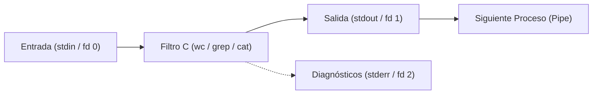

# Módulo 01: Correlación entre K&R C, la Filosofía UNIX y OpenBSD

## 1. La Génesis: K&R y el Modelo de Programación en C

El libro clásico de Brian W. Kernighan y Dennis M. Ritchie, *The C Programming Language* (conocido universalmente como **K&R**), no fue concebido únicamente como un manual de sintaxis. Fue el manifiesto fundacional de un paradigma operativo: la simbiosis entre un lenguaje de programación de sistemas y un sistema operativo modular, **UNIX**.

En el diseño original de Ken Thompson y Dennis Ritchie en los Laboratorios Bell:
- El lenguaje C provee tipos primitivos estrechamente alineados con la arquitectura de la máquina (punteros, enteros, arrays), pero sin sobrecarga de runtime.
- El sistema operativo provee una pequeña colección de llamadas al sistema primitivas y ortogonales (`open`, `read`, `write`, `close`, `fork`, `exec`).
- Las herramientas de usuario se componen como filtros encadenados mediante tuberías (*pipes*).



---

## 2. La Filosofía UNIX y la Estructura Canónica de OpenBSD

La filosofía UNIX resumida por Doug McIlroy establece:
1. **Haz que cada programa haga una sola cosa y la haga bien.**
2. **Espera que la salida de cada programa se convierta en la entrada de otro programa aún desconocido.**
3. **Diseña programas para ser probados temprano, preferiblemente en semanas, no años.**

OpenBSD es, entre todos los sistemas operativos modernos, el descendiente más puro y directo de la rama BSD de Berkeley (386BSD, 4.4BSD-Lite). A diferencia de las distribuciones GNU/Linux —donde el runtime y las herramientas principales provienen de GNU (con implementaciones ricas en opciones no estándar y macros extensas)— OpenBSD mantiene un árbol de fuentes unificado donde el kernel y el *userland* se desarrollan bajo un estándar de codificación riguroso: el **KNF (Kernel Normal Form)**.

El código de OpenBSD se distingue por:
- **Claridad idiomática**: Código conciso, estructurado con funciones breves y manejo de errores inmediato.
- **Seguridad por defecto**: Reemplazo de funciones propensas a desbordamientos (`strcpy`, `strcat`, `sprintf`) por variantes con tamaño delimitado (`strlcpy`, `strlcat`, `snprintf`), parsing numérico estricto con `strtonum`, y reducción de privilegios proactiva con `pledge(2)` y `unveil(2)`.
- **Independencia de binarios**: A diferencia de BusyBox (que agrupa cientos de applets en un solo ejecutable multicall), cada herramienta de OpenBSD (`cat`, `wc`, `head`) es un programa autónomo, auditable y enlazado de forma limpia.

---

## 3. Paralelismos Capítulo a Capítulo: De K&R al Código Real de OpenBSD

### 3.1. Capítulo 1 de K&R: Conteo de Caracteres, Palabras y Líneas vs `wc(1)`

En el Capítulo 1 (Sección 1.5.4) de K&R, se presenta el célebre programa de conteo de palabras:

```c
/* K&R - Sección 1.5.4 (Conteo de palabras canónico) */
#define IN  1  /* dentro de una palabra */
#define OUT 0  /* fuera de una palabra */

main() {
    int c, nl, nw, nc, state;
    state = OUT;
    nl = nw = nc = 0;
    while ((c = getchar()) != EOF) {
        ++nc;
        if (c == '\n')
            ++nl;
        if (c == ' ' || c == '\n' || c == '\t')
            state = OUT;
        else if (state == OUT) {
            state = IN;
            ++nw;
        }
    }
    printf("%d %d %d\n", nl, nw, nc);
}
```

Al comparar este ejemplo con el código fuente de OpenBSD en [`usr.bin/wc/wc.c`](file:///d:/RE-estudiar/coreutils/openbsd-src/usr.bin/wc/wc.c), descubrimos la misma máquina de estados, pero optimizada para buffers de alto rendimiento en bloques de 64 KB (`_MAXBSIZE`):

```c
/* OpenBSD usr.bin/wc/wc.c (Líneas 157-171) */
if (doword) {
    gotsp = 1;
    while ((len = read(fd, buf, _MAXBSIZE)) > 0) {
        charct += len;
        for (C = buf; len--; ++C) {
            if (isspace((unsigned char)*C)) {
                gotsp = 1;
                if (*C == '\n')
                    ++linect;
            } else if (gotsp) {
                gotsp = 0;
                ++wordct;
            }
        }
    }
}
```

> **Lección de Porteo**: El algoritmo conceptual es idéntico al que K&R enseñaban en 1978. La diferencia en un sistema de producción radica en sustituir el `getchar()` con buffer de un solo carácter por bloques `read(fd, buf, _MAXBSIZE)`, y la inclusión de banderas para caracteres multibyte (`wchar_t`) y unidades legibles por humanos (`-h`).

---

### 3.2. Capítulo 5 de K&R: Punteros y Argumentos de Línea de Comandos vs `echo(1)`

En K&R Capítulo 5.10, el análisis de los argumentos `argc` y `argv` se ilustra con dos variantes de `echo`:

```c
/* K&R 5.10 - Versión 2 de echo con punteros */
main(int argc, char *argv[]) {
    while (--argc > 0)
        printf("%s%s", *++argv, (argc > 1) ? " " : "");
    printf("\n");
    return 0;
}
```

En OpenBSD [`bin/echo/echo.c`](file:///d:/RE-estudiar/coreutils/openbsd-src/bin/echo/echo.c), el estándar POSIX exige que `echo` **no** utilice `getopt(3)` (debido a la compatibilidad histórica con argumentos que inician con `-`), sino un recorrido directo sobre `argv`:

```c
/* OpenBSD bin/echo/echo.c (Líneas 51-68) */
for (++argv; argv[0] && *argv[0] == '-'; argv++) {
    for (p = *argv + 1; *p != '\0'; p++) {
        switch (*p) {
        case 'n': nflag = 1; break;
        case 'e': eflag = 1; break;
        case 'E': eflag = 0; break;
        default:  goto echoargs;
        }
    }
}
```

---

### 3.3. Capítulo 8 de K&R: La Interfaz del Sistema UNIX (`read`, `write`, `stat`, `dirent`)

El Capítulo 8 es la cumbre de K&R: describe la interfaz de bajo nivel que conecta a C con el kernel. Allí se definen:
1. **Descriptores de archivo**: enteros `0`, `1`, `2` asociados a stdin, stdout y stderr.
2. **Entrada/Salida sin formato**: `read(int fd, char *buf, int n)` y `write(int fd, char *buf, int n)`.
3. **Inspección de archivos**: `fstat()` y el formato de los directorios.
4. **Recorrido de directorios**: En la Sección 8.6, K&R presentan una implementación didáctica de `opendir()` y `readdir()`.

En OpenBSD:
- `cat.c` implementa dos rutas: `raw_cat()` (que opera exclusivamente con `read` y `write` de bajo nivel) y `cook_buf()` (que opera con streams de alto nivel `FILE *` para formatear caracteres no imprimibles y numeración).
- `ls.c` lleva el recorrido de directorios de K&R al siguiente escalón mediante `fts(3)`, soportando ordenamiento recursivo, detección de ciclos y prevención de agotamiento de descriptores de archivo.

---

## 4. Comparación Arquitectónica: OpenBSD vs BusyBox

Al comparar ambos árboles de fuentes en nuestro entorno de trabajo:

| Dimensión | OpenBSD Coreutils (`openbsd-src/`) | BusyBox (`busybox-src/`) |
| :--- | :--- | :--- |
| **Estructura** | Binarios independientes (`cat.exe`, `ls.exe`, `wc.exe`) | Un solo binario multicall (`busybox.exe <applet>`) |
| **Estilo de Código** | KNF estricto, C estándar puro, limpio y legible | Densamente condicionado con `#if ENABLE_*` y macros de optimización |
| **Gestión de Memoria** | Claridad, `reallocarray`, `free()` al finalizar | Minimización obsesiva de tamaño (`xmalloc`, buffers globales reutilizados) |
| **Recorrido de Directorios** | Utiliza `fts(3)` robusto y completo | Utiliza bucles directos `opendir/readdir` para ahorrar bytes de código |
| **Propósito Principal** | Fidelidad a estándares POSIX/BSD, seguridad, claridad pedagógica | Máxima compresión para sistemas embebidos e initramfs |

Para quien estudia C a partir de libros clásicos como Kernighan & Ritchie, el código de **OpenBSD** es el texto canónico por excelencia: legible, elegante, modular y directamente extrapolable a cualquier entorno de desarrollo moderno.
